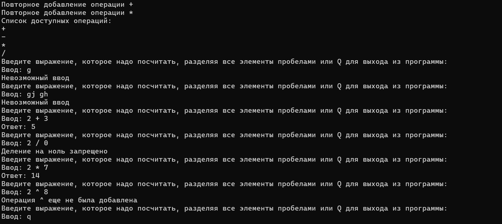

# Консольное учебное приложение "Калькулятор" для отработки навыков работы с *делегатами*

Был создан отдельный статический класс `Calc`, который имеют следующие возможности:  
1. Добавление математической операции в калькулятор `Add_Operation`
2. Получение списка добавленных операций `ListOperation`
3. Вычисление значения математического выражения `Calculation`

Преимущество данного подхода в том, что класс полностью абстрагируется от конкретных операций.  
В классическом виде калькулятор пишут с помощью конструкция `if-else` или `switch`.  
Здесь же такого нет, тип операции и ее реализация хранятся в отдельное переменной словаря `Dictionary<char, Func<double, double, double>>`.

Кроме того, данная работа прекрасно дает возможность отработать такие темы как:  
* Анонимные функции
* Лямбда-выражения
* Обработка исключений

Пример работы программы:  
